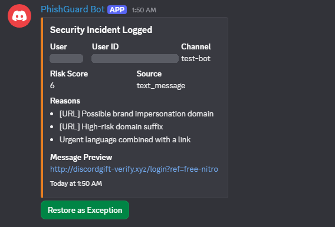
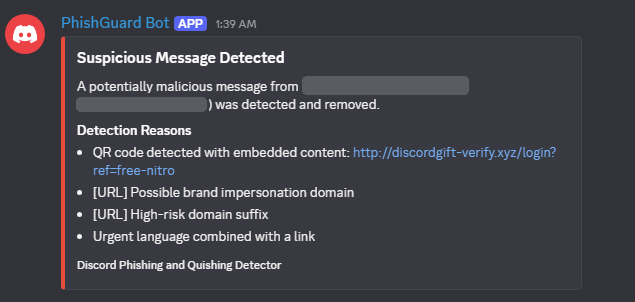
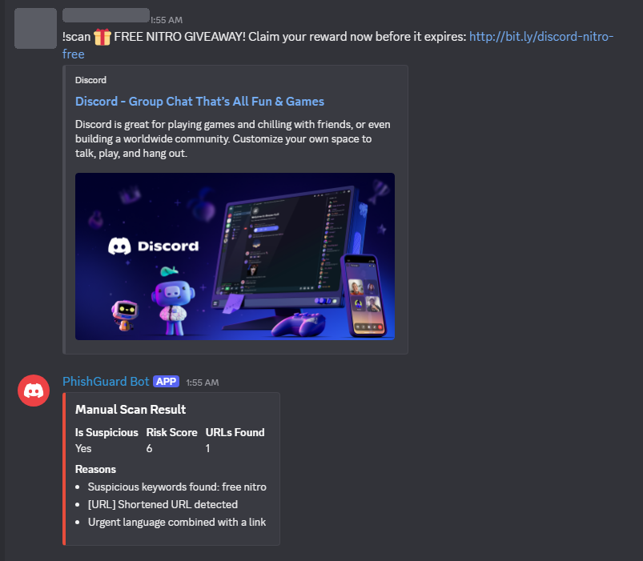
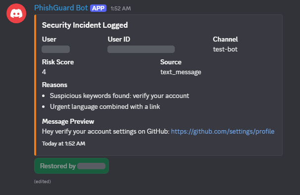

#  Phishing & Quishing Detector Bot

A Discord bot that detects **phishing links** and **malicious QR codes (quishing)** in real time, deletes them, warns the channel, and logs every incident for moderators.

Built as a team project for **FC382 – Defense Mechanisms** at the University of Prince Mugrin (Spring 2026).



---

## ✨ Features

- **Real-time message scanning**: every message in the server is analyzed automatically
- **QR code (quishing) detection**: decodes QR codes in image attachments with OpenCV and scans the hidden link
- **URL analysis**: flags shortened links, IP-based URLs, the `@` redirect trick, brand-impersonation domains, excessive hyphens, and high-risk TLDs (`.zip`, `.click`, `.shop`, `.xyz`)
- **Keyword detection**: catches common social-engineering phrases ("free nitro", "verify your account", ...)
- **Research-based risk scoring**: each indicator adds weighted points (weights sourced from OWASP, APWG, and MITRE ATT&CK)
- **Automated response**: deletes the message, posts a temporary warning, and sends a detailed report to a `#security-logs` channel
- **Restore as Exception**: admins can restore false positives with one click, and every restore is recorded in an audit trail
- **Trusted roles**: admins and moderators are exempt from scanning
- **Logging**: every incident is saved as a JSON line in `logs/attacks.log`

## 🧮 Risk Scoring

| Indicator | Points |
|---|---|
| Suspicious keywords | +2 |
| Urgent language + link | +2 |
| Shortened URL | +2 |
| Direct IP-based URL | +2 |
| `@` symbol in URL | +2 |
| Brand impersonation domain | +3 |
| 2+ hyphens in domain | +1 |
| High-risk TLD | +1 |
| Link hidden in a QR code | +1 |

A message is flagged as phishing when its total score reaches **3**.

## 🗺️ MITRE ATT&CK Mapping

| Technique | Name |
|---|---|
| T1566 | Phishing |
| T1566.002 | Spearphishing Link |
| T1204.001 | User Execution: Malicious Link |
| T1656 | Impersonation |

## 🛠️ Technologies

`Python` · `discord.py` · `OpenCV` · `python-dotenv` · `Regex`

## 📁 Project Structure

```
├── bot.py                      # Discord events, scanning workflow, commands
├── detector/
│   ├── phishing_detector.py    # Text & URL analysis + risk scoring
│   └── qr_detector.py          # QR code decoding (OpenCV)
├── .env.example                # Configuration template
└── requirements.txt
```

## 🚀 How to Run

1. Create a bot in the [Discord Developer Portal](https://discord.com/developers/applications) and enable **Message Content Intent** and **Server Members Intent**
2. Install the dependencies:
   ```bash
   pip install -r requirements.txt
   ```
3. Copy `.env.example` to `.env` and fill in your bot token and log channel ID
4. Run the bot:
   ```bash
   python bot.py
   ```

## 💬 Commands

| Command | Description |
|---|---|
| `!scan <text>` | Manually test any text against the detector |
| `!ping` | Check bot latency |
| `!helpme` | Show available commands |

## 📸 Screenshots

| QR code detection | Manual scan |
|---|---|
|  |  |

**Admin restoring a false positive:**



## ⚠️ Limitations & Future Work

- Integrate a URL reputation API (VirusTotal / Google Safe Browsing)
- Detect lookalike characters (homoglyphs / Punycode) and typosquatting
- Train a machine-learning classifier to reduce false positives
- Add a `!stats` command and admin whitelist command
- Scan QR codes inside PDFs and documents
- Deploy with Docker on a hosted server

## 👥 Team

- **Rawah Alsaadi**: developed `bot.py` (Discord events, scanning workflow, automated response, security logging, Restore as Exception button, trusted roles, and commands)
- **Shatha Sharaf**: developed `detector/phishing_detector.py` (text & URL analysis, keyword detection, brand impersonation checks, and risk scoring)
- **Jehan Ayman**: developed `detector/qr_detector.py` (QR code decoding from image attachments using OpenCV)
